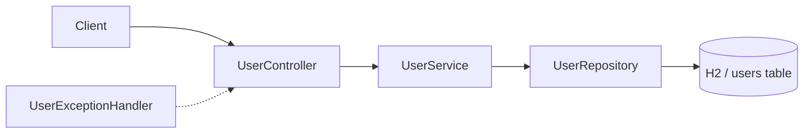

# user-service

A small **Spring Boot** REST API that manages users (name and email). The app uses a classic **controller → service → repository** layout, persists data with **JPA and H2**, and exposes JSON under `/api/users`.

## Tech stack

| Piece | Choice |
|--------|--------|
| Framework | Spring Boot **4.1.2** (`webmvc`, `data-jpa`, `validation`) |
| Java | **25** (Gradle toolchain) |
| Database | **H2** file database in development (`./data/userdb`); in-memory for tests |
| Build | Gradle with Spring dependency management |

The H2 console is enabled at `/h2-console` for local development (`web-allow-others: false`).

## Architecture



| Layer | Responsibility |
|--------|------------------|
| `UserController` | HTTP mapping on `/api/users` |
| `UserService` | Business rules, transactions, DTO mapping |
| `UserRepository` | Spring Data JPA (`JpaRepository<User, Long>`) |
| `User` | JPA entity mapped to table `users` |
| DTOs | Java records for requests and responses; the entity is not exposed directly |
| `UserExceptionHandler` | Maps domain and validation errors to RFC 7807 `ProblemDetail` responses |

## Domain model

The `User` entity includes:

- `id` — auto-generated identity
- `name` — required, maximum 100 characters
- `email` — required, unique in the database
- `createdAt` / `updatedAt` — set via `@PrePersist` and `@PreUpdate`

A protected no-args constructor supports JPA; a two-argument constructor is used when creating users in the service.

## REST API

Base URL: `http://localhost:8080/api/users`

| Method | Path | Status | Behavior |
|--------|------|--------|----------|
| `GET` | `/api/users` | 200 | List all users |
| `GET` | `/api/users/{id}` | 200 / 404 | Get one user by id |
| `POST` | `/api/users` | 201 | Create (`CreateUserRequest`) |
| `PUT` | `/api/users/{id}` | 200 / 404 | Update (`UpdateUserRequest`) |
| `DELETE` | `/api/users/{id}` | 204 / 404 | Delete by id |

`UserResponse` includes `id`, `name`, `email`, `createdAt`, and `updatedAt`.

Create and update bodies are validated (`@Valid`): non-blank name (max 100), valid email format.

## Business rules

Implemented in `UserService`:

- **Duplicate email** — Before create, and on update when the email changes, `existsByEmailIgnoreCase` is checked. A conflict raises `DuplicateEmailException` → HTTP **409 Conflict**.
- **Missing user** — Lookups, update, and delete when the id does not exist raise `UserNotFoundException` → HTTP **404 Not Found**.
- **Transactions** — The service class is `@Transactional(readOnly = true)`; `create`, `update`, and `delete` use `@Transactional` for writes.

Email uniqueness is enforced in application code (case-insensitive) and with a unique column on the entity.

## Error handling

`UserExceptionHandler` (`@RestControllerAdvice`) returns `ProblemDetail`:

| HTTP status | Cause |
|-------------|--------|
| 404 | User not found |
| 409 | Duplicate email |
| 400 | Bean validation on the request body |

## Configuration

**Runtime** (`src/main/resources/application.yml`):

- Server port **8080**
- File-backed H2: `jdbc:h2:file:./data/userdb`
- JPA `ddl-auto: update`, SQL logging with formatting

**Tests** (`src/test/resources/application-test.yml`, profile `test`):

- In-memory H2, `create-drop` schema

## Running the application

Change into the project directory first (`user-service`); the wrapper is only there, not in the parent `java` folder.

**Git Bash, WSL, macOS, Linux** — use the shell wrapper (do not type bare `gradlew.bat` in bash):

```bash
cd user-service
./gradlew bootRun
```

**Windows PowerShell or CMD** — from `user-service`:

```bat
.\gradlew.bat bootRun
```

If bash says `command not found` for `gradlew.bat`, you are usually in the wrong directory or omitted `./` / `.\` before the script name.

Data survives restarts in `./data/userdb` because of the file datasource.

## Tests

```bash
./gradlew test
```

| Test | Purpose |
|------|---------|
| `UserServiceApplicationTests` | Smoke test that the Spring context loads |
| `UserControllerIntegrationTest` | `MockMvc` integration test: create user (201), list users (200), assert JSON fields |

## Design notes

**Strengths:** Clear layering, records for API contracts, centralized exception handling, integration coverage for the main happy path.

**Possible extensions (not implemented):** Pagination on list endpoints, partial update (PATCH), authentication, a production database instead of H2, and broader tests (404, 409, validation failures).